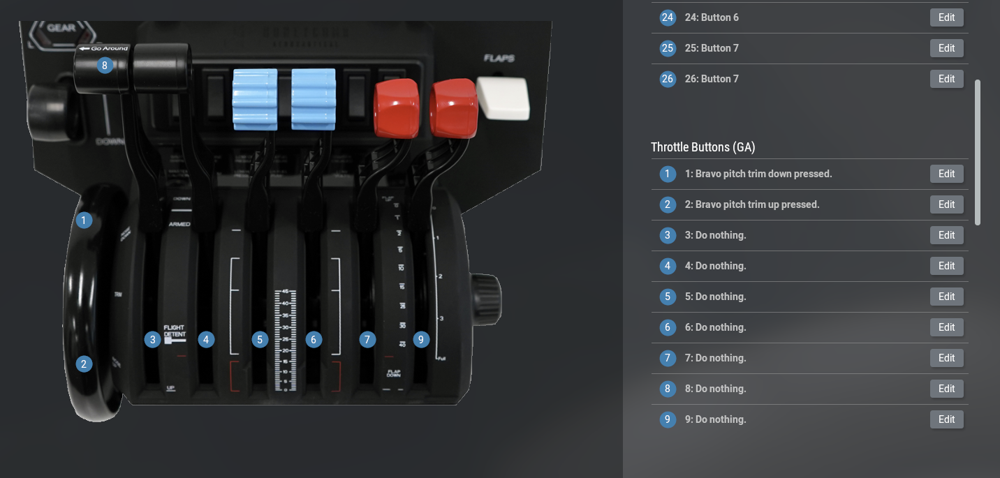

# Install

::: danger v2 requires X-Plane 12.4.4 or newer
zoal-honeycomb v2 runs on **X-Plane 12.4.4+** only, on **Apple Silicon Macs**, **Windows x64** and **Linux x64**.
**X-Plane 11 and Intel Macs are no longer supported.**

Not sure? Check before installing:

- **X-Plane version:** the first line of `Log.txt` in your X-Plane folder, e.g. `Log.txt for X-Plane 12.4.4-r1 ...`
- **Mac chip:** Apple menu → **About This Mac**. "Chip: Apple M…" is Apple Silicon; "Processor: Intel" is not.

On an older setup, stay on **[v1.18.0](https://github.com/x-z7a/zoal-honeycomb/releases/tag/v1.18.0)** and use the **[v1 docs](/v1/)**.
:::

## Install v2

1. Download `zoal-honeycomb.zip` from the [Release Page](https://github.com/x-z7a/zoal-honeycomb/releases/latest).
2. Drop the `zoal-honeycomb` folder into `X-Plane 12/Resources/plugins/`.
3. Start X-Plane and open **Plugins → ZOAL Honeycomb → Configurator**.
4. See the mappings below for knobs and AP buttons.

Upgrading from v1? See the [Upgrade Guide](/upgrade) first.

## Bravo Knobs Mapping

## Bravo AP Buttons Mapping

Mappings can be found by searching `honeycomb` after clicking `Edit` in X-Plane.

## Smooth Trim Wheel

Use plugin's trim up/down

Watch the demo video:

<iframe width="560" height="315" src="https://www.youtube.com/embed/vriTIxtnZcE" title="YouTube video" frameborder="0" allowfullscreen></iframe>

## Configurator

The profile editor runs inside X-Plane (12.4.4 or newer): open
**Plugins → ZOAL Honeycomb → Configurator**. Edits are saved to the plugin's
`user profiles/` folder and take effect immediately.

