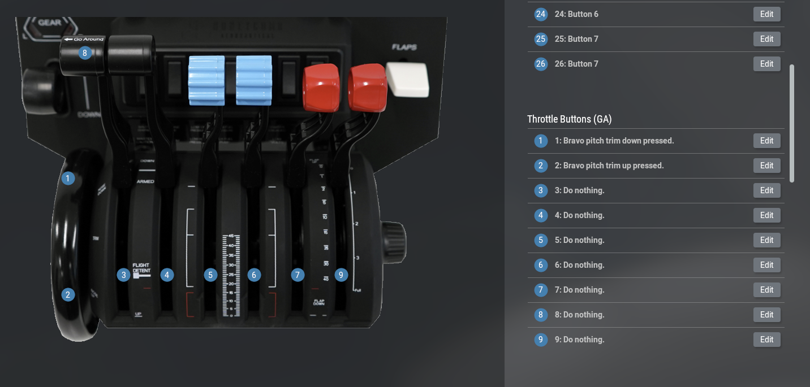

# Install

::: warning Archived: v1 documentation
These docs are for **zoal-honeycomb v1** (latest: [v1.18.0](https://github.com/x-z7a/zoal-honeycomb/releases/tag/v1.18.0)), which supports X-Plane 11, X-Plane 12 before 12.4.4, and Intel Macs.
On X-Plane 12.4.4 or newer? Use [v2](/) instead.
:::

1. Download `zoal-honeycomb.zip` from the [v1.18.0 release](https://github.com/x-z7a/zoal-honeycomb/releases/tag/v1.18.0).
2. Drop the folder into X-Plane's plugins folder.
3. See the mappings below for knobs and AP buttons.

## Bravo Knobs Mapping

## Bravo AP Buttons Mapping

Mappings can be found by searching `honeycomb` after clicking `Edit` in X-Plane.

## Smooth Trim Wheel

Use plugin's trim up/down

Watch the demo video:

<iframe width="560" height="315" src="https://www.youtube.com/embed/vriTIxtnZcE" title="YouTube video" frameborder="0" allowfullscreen></iframe>

## GUI Configurator

